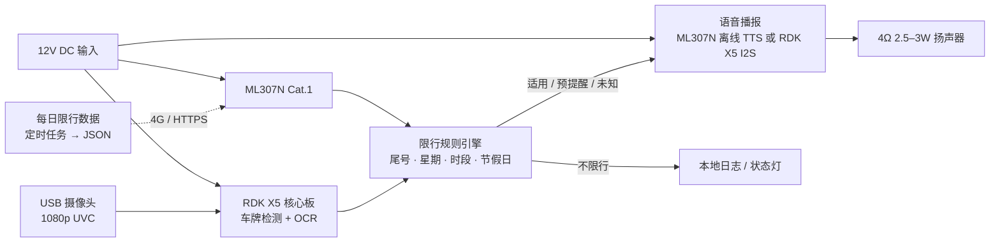

# 限行哨兵 · Plate Limit Guard

**2026 华秋杯 AI 开源硬件创新设计大赛参赛作品**

基于 RDK X5 核心板与 ML307N Cat.1 模组的门岗车牌识别 + 当日限行语音提醒装置。

> An open-source edge-AI device that recognizes license plates at a residential gate and reminds drivers when their car is restricted in Beijing today. Built on D-Robotics RDK X5 and China Mobile ML307N, with open hardware, open firmware, and a daily restriction-data pipeline.

[](LICENSE)
[](LICENSES/Apache-2.0.txt)
[](LICENSES/CC-BY-4.0.txt)
[](#项目状态)

## 为什么做这个

北京工作日 07:00–20:00 在五环路以内按车牌尾号限行，尾号每 13 周轮换一次；外埠车辆还有早晚高峰禁入规则。很多车主不是不知道规则，而是记不住今天轮到哪两个尾号。

限行哨兵装在小区、园区或单位门口：车辆驶过时识别车牌，联网获取当天限行信息；如适用规则可确认，则进行语音提醒。设备只做提醒，不控制道闸、不做人脸识别，摄像头画面在设备本地处理。

## 项目状态

**v0.1 · 规格阶段（2026-10-27）**

仓库刚刚初始化。当前交付物是产品规格、硬件特性规格、软件设计、测试计划、系统设计基线与 KiCad 工程骨架；原理图尚未开始，固件尚未实现。硬件待确认项在 [docs/02-hardware-spec.md](docs/02-hardware-spec.md)；规则数据待决项在[数据契约 v2](docs/07-data-contract-v2.md)；系统级冻结门禁在[系统设计基线](docs/06-system-design-baseline.md)。

## 核心功能

| 优先级 | 功能 | 说明 | 状态 |
| --- | --- | --- | --- |
| P0 | 车牌识别 | USB 摄像头采集，RDK X5 完成检测与字符识别，首版支持蓝牌、绿牌 | 规格中 |
| P0 | 限行数据每日更新 | ML307N 通过 4G 拉取当天签名规则包，本地缓存最近 7 天（仅当天包可用于判断） | 规格中 |
| P0 | 限行判断 | 京牌蓝牌尾号为主；绿牌、黄牌、外埠默认未知，除非规则包明确覆盖且可核验；节假日与调休由规则包提供 | 规格中 |
| P0 | 语音提醒 | 对适用规则的车辆播报提醒；预提醒与当前限行分文案，默认不播完整车牌 | 规格中 |
| P1 | 去重与防打扰 | 同一车牌同一通知类型 10 分钟内只播报一次；预提醒升级为当前限行不受限 | 已设计 |
| P1 | 离线降级 | 只使用适用于当日且可信的缓存；条件不足时提示状态未知 | 设计中 |
| P1 | 隐私保护 | 图片不上传、不落盘；日志默认脱敏 | 已设计 |
| P2 | 扩展接口 | 地感/雷达触发、继电器、红外补光、以太网/PoE | 规划 |

## 系统架构



更完整的电源树、接口定义与设计决策见 [docs/02-hardware-spec.md](docs/02-hardware-spec.md)；软件流水线与数据契约见 [docs/03-software-design.md](docs/03-software-design.md)。

设计评审与冻结前的决策、边界和验证门禁见 [系统设计基线](docs/06-system-design-baseline.md)；规则数据的字段、签名、覆盖度与撤回语义见[数据契约 v2 设计](docs/07-data-contract-v2.md)。现有 v1 数据样例尚未完成适用条件等完整性核验，不用于实际判断。

冻结前问题与验证建议见[数据契约审查](docs/08-design-review-v2.md)和[硬件接口审查](docs/09-hardware-review.md)。

## 硬件平台

| 模块 | 选型 | 关键规格 | 来源 |
| --- | --- | --- | --- |
| 主控 | RDK X5 Module | 8×Cortex-A55 @1.5GHz，10 TOPS BPU，4/8GB LPDDR4，5V/5A 供电 | 大赛合作平台（地瓜机器人） |
| 通信 | ML307N Cat.1 | RISC-V Cat.1，3.8V 典型供电、2A 瞬时电流（以手册为准），1.8V UART，支持离线 TTS | 大赛合作平台（中移物联） |
| 摄像 | USB 2.0 UVC | 1080p、WDR、可选 IR-CUT | 自购 |
| 音频 | 2.5–3W Class-D + 4Ω 扬声器 | 5V 供电，PAM8302A 或 MAX98357A | 自购 |
| 电源 | 12V DC 输入 | 12V→5V/6A（X5）、12V→3.8V/3A（LTE，模组峰值 2A）、5V→3.3V/2A | 自研底板 |
| 存储 | Micro SD | 系统盘；模块是否带 eMMC 待官方资料确认 | 自购 |
| 时钟 | RTC 备份电池 | 按 RDK X5 官方参考设计 | 自研底板 |

## 仓库结构

```text
.
├─ docs/                  # 产品、硬件、软件、测试、大赛合规文档及前期资料
├─ hardware/
│  ├─ kicad/              # KiCad 工程（v0.1 空白骨架）
│  └─ fab/                # Gerber / BOM / 坐标文件（发布时提交）
├─ firmware/              # RDK X5 端应用与 ML307N 驱动（待实现）
├─ data/                  # 每日限行数据契约与示例
├─ mechanical/            # 外壳与结构（待设计）
├─ LICENSES/              # Apache-2.0 / CC BY 4.0 全文
├─ LICENSE                # CERN-OHL-S-2.0（硬件）
├─ NOTICE                 # 版权与第三方声明
└─ README.md
```

## 开源范围与许可证

本项目按内容类型分别授权，覆盖大赛要求的硬件设计、固件与文档：

| 内容 | 许可证 | 文件 |
| --- | --- | --- |
| 原理图、PCB、Gerber、BOM、结构件 | CERN Open Hardware Licence v2 — Strongly Reciprocal | [LICENSE](LICENSE) |
| 固件、软件、脚本 | Apache License 2.0 | [LICENSES/Apache-2.0.txt](LICENSES/Apache-2.0.txt) |
| 文档、图片、演示材料 | Creative Commons Attribution 4.0 | [LICENSES/CC-BY-4.0.txt](LICENSES/CC-BY-4.0.txt) |

第三方模型、库、参考设计遵循各自许可证；选型时必须核验并记录在 [docs/05-competition-compliance.md](docs/05-competition-compliance.md)。转载或复现请保留出处与许可证声明。版权与第三方声明见 [NOTICE](NOTICE)。

## 快速开始

当前处于规格阶段，以下为开发板预研路线，不代表已有可运行固件：

1. 准备 RDK X5 开发套件、USB 摄像头、ML307N 评估板或转接板、4Ω 扬声器、12V/5A 电源。
2. 按地瓜官方文档烧录 Ubuntu 22.04 镜像，完成 SSH 与摄像头出图。
3. 按 [firmware/README.md](firmware/README.md) 的顺序做三个冒烟测试：摄像头采集、ML307N 4G HTTP、TTS 播报。
4. 规则引擎与数据格式先看 [docs/03-software-design.md](docs/03-software-design.md)、[data/README.md](data/README.md) 和[数据契约 v2](docs/07-data-contract-v2.md)。
5. 硬件底板从 [hardware/kicad/](hardware/kicad/) 开始；先评审 [docs/02-hardware-spec.md](docs/02-hardware-spec.md)，不要直接布线。

## 开发阶段

当前处于规格设计阶段。后续依次进入原理图、PCB、固件与 AI 联调、整机测试和提交。

参赛前的选题、开发板调研和工作记录已整合至 [前期资料索引](docs/preparation/README.md)。这些历史资料保留了当时的假设和候选方向，当前作品与计划以本 README 和 `docs/` 为准。

## 贡献

欢迎通过 Issue 和 Pull Request 参与。贡献者名单以 GitHub 的 [Contributors](https://github.com/no010/hqcup2026-plate-limit-guard/graphs/contributors) 页面为准。复现或改进请注明本项目出处，并遵守对应许可证。

## 大赛信息

- 大赛详情：[2026 华秋杯 AI 开源硬件创新设计大赛](https://p.eda.cn/act/hqcup2026)
- 报名表：[腾讯文档报名页](https://docs.qq.com/form/page/DU1hJdE1KZ3VvRFpt)
- EDA 工具：计划使用官方 KiCad 10；现有空白工程以 KiCad 8 格式初始化，跨版本打开与保存尚未验证。[KiCad 华秋版](https://kicad.eda.cn)为大赛推荐工具，具体要求以官方规则为准。
- 参赛要求：使用指定硬件平台；作品首发开源，包含 PCB 与文档；具体规则以大赛官方页面为准
- 打样券：最高 2000 元 PCB/PCBA 打样券，合格作品可领 100 元券；使用规则见大赛页面

## 免责声明

本项目是参赛作品，不是华秋、地瓜机器人、中移物联的官方项目。限行规则与数据仅供参考，最终以北京市人民政府、北京市公安局公安交通管理局发布的通告为准。设备只做提醒，不构成执法或通行许可依据。

## 致谢

- [D-Robotics RDK X5 文档](https://developer.d-robotics.cc/rdkx5)
- 中移物联 ML307N 系列模组（资料以大赛官方发放为准）
- [北京市人民政府限行通告](https://www.beijing.gov.cn/zhengce/zhengcefagui/202603/t20260323_4564097.html)
- [KiCad](https://www.kicad.org/)
