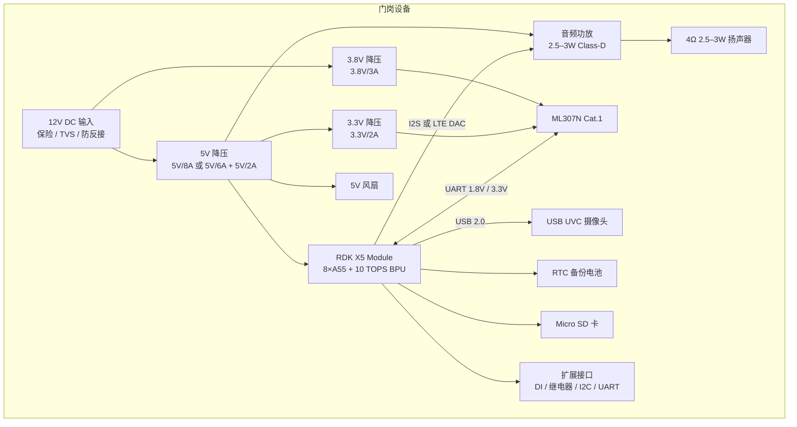
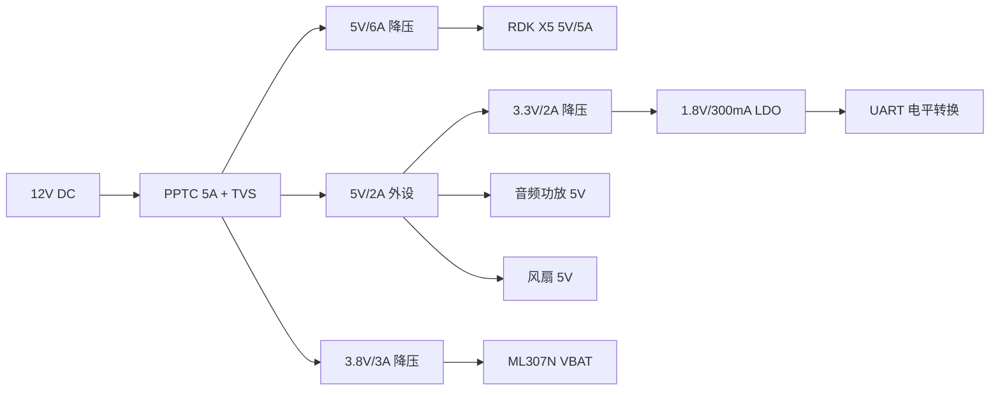

# 硬件特性规格：限行哨兵主板

> 版本：v0.1（草案） · 日期：2026-10-27 · 状态：规格评审中，未开始原理图
> 关联文档：[产品规格](01-product-spec.md) · [软件设计](03-software-design.md) · [测试计划](04-test-plan.md) · [大赛合规](05-competition-compliance.md)
> 本页器件参数、时序、电容和测试值均为未经验证的设计假设，不能直接用于原理图或采购。接口、电源、音频与结构的冻结门禁见 [系统设计基线](06-system-design-baseline.md)；不得将开发板适配器额定值视为核心板实测峰值。

## 1. 设计目标与原则

1. **核心板不自研**：以 RDK X5 Module 为计算核心，底板从官方 Carrier Board 参考设计出发，避免重复造轮子。
2. **单电源输入**：门岗现场只引一路 12V DC，底板产生 5V、3.8V、3.3V、1.8V。
3. **先开发板、后打板**：摄像头、4G、TTS 三条链路先在开发板上跑通，再冻结底板接口。
4. **够用 + 可扩展**：首版只做识别、判断、播报；地感、继电器、以太网、PoE 留在扩展座。
5. **可制造**：4 层板、常规工艺、华秋 DFM 可检查；关键网络留测试点。
6. **全开源**：原理图、PCB、Gerber、BOM、结构件全部按 CERN-OHL-S-2.0 发布。

> EDA 工具说明：项目选定官方 KiCad 10。现有空白工程以 KiCad 8 格式初始化，其跨版本打开与保存尚未验证；本文不升级工程。更多硬件冻结前审查见 [硬件接口审查](09-hardware-review.md)。大赛 EDA 具体要求以官方规则为准。

## 2. 系统框图

说明：

- 5V 为主功率轨；核心板峰值电流待按实际型号与运行工况核验。5V/6A 主轨和 5V/2A 外设轨只是初步预算方案，并非选型结论。
- 3.8V 只给 ML307N，必须能承受 2A 瞬时电流，不能与 3.3V 合并。
- 音频有两条候选路径：ML307N 离线 TTS 模拟输出，或 RDK X5 I2S + MAX98357A。接口和隔离方式须按器件手册设计，尚未选定切换电路。

## 3. 关键器件与选型

| 类别 | 选型 | 关键参数 | 状态 |
| --- | --- | --- | --- |
| 主控 | RDK X5 Module 4GB/8GB | 8×Cortex-A55 @1.5GHz，10 TOPS BPU，4/8GB LPDDR4，5V/5A | 大赛提供；引脚与存储待官方资料确认 |
| 4G | ML307N（-DL/-DC 优先） | Cat.1，3.8V 典型供电（子型号以手册为准），2A 瞬时，1.8V UART，离线 TTS | 大赛提供；子型号待确认 |
| 5V 主降压 | 待选型 | 12V→5V/6A，效率 ≥90%，低纹波 | 待选型 |
| 5V 外设降压 | 待选型 | 12V→5V/2A | 待选型 |
| 3.8V 降压 | 待选型 | 12V→3.8V/3A，瞬态响应好 | 待选型 |
| 3.3V 降压 | 待选型 | 5V→3.3V/2A | 待选型 |
| 1.8V LDO | 待选型 | 3.3V→1.8V/300mA，给电平转换 | 待选型 |
| 电平转换 | 待选型 | 1.8V↔3.3V，≥1Mbps，双通道 | 待选型 |
| 音频功放 A | PAM8302A | 模拟输入，单声道 2.5W/4Ω | 首选，待验证 ML307N TTS |
| 音频功放 B | MAX98357A | I2S 输入，3.2W/4Ω | 备选 |
| 摄像头 | USB 2.0 UVC | 1080p30 MJPEG，WDR，可选 IR-CUT | 待选型 |
| 存储 | Micro SD | UHS-I，工业级 32GB | 待选型 |
| SIM | Nano SIM 座 | 6 pin，1.8V/3.0V 自适应 | 待选型 |
| LTE 天线 | FPC/IPEX 或 SMA | 50Ω，按模组频段选 | 待选型 |
| RTC 备份 | 按官方参考设计 | 3V，充放电要求以官方为准 | 待确认 |
| 输入保护 | PPTC + TVS + P-MOS | 12V 输入，5A | 待选型 |
| 风扇 | 5V 30/40mm | PWM + 测速 | 可选 |

## 4. 电气规格

### 4.1 输入

| 项目 | 规格 |
| --- | --- |
| 输入电压 | 12V DC ±10% |
| 输入电流 | 最大 5A |
| 推荐适配器 | 12V/5A（60W），DC 5.5×2.1 或 2-pin 5.08mm 端子 |
| 输入保护 | 5A PPTC、SMBJ15A TVS、P-MOS 防反接、输入滤波 |
| 接地 | 根据接口、器件手册和电流回流路径设计；布局及 EMC 验证后确定 |

### 4.2 电源树

### 4.3 电源预算

| 负载 | 电压 | 典型电流 | 峰值电流 | 典型功率 | 峰值功率 |
| --- | --- | --- | --- | --- | --- |
| RDK X5 Module | 5V | 1.5A | 5A | 7.5W | 25W |
| ML307N | 3.8V | 0.3A | 2A | 1.1W | 7.6W |
| 摄像头 | 5V | 0.2A | 0.5A | 1.0W | 2.5W |
| 音频功放 | 5V | 0.2A | 1A | 1.0W | 5W |
| 逻辑与外设 | 3.3V | 0.1A | 0.3A | 0.3W | 1.0W |
| 合计 | — | — | — | 约 11W | 约 41W |

表中峰值是各负载同时达到峰值的保守相加，约 41W 输出；按 85% 效率估算，输入典型约 13W，峰值约 48W。各电源轨的额定峰值（5V_X5 7A/10ms、5V_PERIPH 3A、3.8V_LTE 3A/1ms）包含器件和布线裕量，不能直接相加当作输入功率。

推荐 12V/5A 适配器，但它是否足够取决于 X5 满载、4G 发射和播报同时发生时的实测输入峰值；该同时峰值必须在开发板上测量。若实测超过 4.5A，改用 12V/6A 适配器，或通过负载时序/限流避免同时峰值。12V/3A 适配器不足以覆盖该场景。

### 4.4 电源轨要求

| 电源轨 | 电压精度 | 连续电流 | 峰值电流 | 纹波目标 | 主要负载 |
| --- | --- | --- | --- | --- | --- |
| 5V_X5 | ±5% | 6A | 7A/10ms | <100mV | RDK X5 |
| 5V_PERIPH | ±5% | 2A | 3A | <100mV | 摄像头、音频、风扇、3.3V |
| 3.8V_LTE | ±5% | 2A | 3A/1ms | <50mV | ML307N |
| 3.3V | ±5% | 1A | 2A | <50mV | 逻辑、LED、扩展 |
| 1.8V | ±5% | 0.1A | 0.3A | <30mV | UART 电平转换 |

3.8V 轨必须在 ML307N 的 VBAT 引脚旁放置至少 2×220µF 低 ESR 电容 + 100µF 陶瓷 + 100nF，走线短而宽；这是 Cat.1 模组稳定工作的关键。

### 4.5 上电、关机与复位

- 12V 上电后，5V、3.8V、3.3V 同时建立；RDK X5 从 SD 卡启动。
- ML307N 的 PWRKEY 由 RDK X5 GPIO 通过 NPN 三极管控制，拉低 1.2s 后释放开机；保留手动按键与测试点。
- RESET 由 RDK X5 GPIO 通过三极管控制，低电平 ≥50ms；保留测试点。
- 预留 ML307N 的 NET_LED 状态输出，可接 LED 或经电平转换接 X5 GPIO。
- 断电重启后设备应自动恢复，不需要人工按键。

### 4.6 保护与 EMC

| 位置 | 保护 | 说明 |
| --- | --- | --- |
| 12V 输入 | PPTC、TVS、P-MOS、共模电感（可选） | 防反接、浪涌、过流 |
| USB | ESD 阵列、限流 | 摄像头热插拔 |
| SIM | ESD、串阻和走线按模组手册确定 | 插拔条件及静电防护待核验 |
| 音频输出 | 磁珠、RC 滤波 | 降低 Class-D 干扰 |
| 扩展 IO | ESD、串阻 | 外部接线 |
| LTE 天线 | 50Ω 阻抗、天线 keep-out | 辐射与接收性能 |
| 风扇 | 续流二极管、限流 | 感性负载 |

## 5. 接口定义

### 5.1 接口清单

| 位号 | 接口 | 类型 | 用途 | 关键参数 | 备注 |
| --- | --- | --- | --- | --- | --- |
| J1 | 12V 输入 | 2-pin 5.08mm 端子 / 5.5×2.1 桶座 | 整机供电 | 12V/5A | 默认端子，桶座可选 |
| J2 | 摄像头 | USB-A | USB UVC 摄像头 | USB 2.0，5V/0.5A | ESD、磁珠 |
| J3 | 服务口 | USB-C 或 4-pin 排针 | 调试/烧录 | USB 2.0 | 可选 |
| J4 | 扬声器 | 2-pin 2.54mm | 4Ω 2.5–3W 扬声器 | Class-D 输出 | 留测试点 |
| J5 | LTE 天线 | IPEX 或 SMA | 4G 主天线 | 50Ω | 金属外壳用 SMA |
| J6 | Micro SD | 推推式卡座 | 系统盘 | UHS-I | 工业级卡 |
| J7 | Nano SIM | 6-pin 卡座 | 4G | 1.8V/3.0V | ESD、短走线 |
| J8 | 扩展 | 2×6 2.54mm 排针 | I2C/UART/GPIO | 3.3V/5V/GND | 可选 |
| J9 | DI/继电器 | 4-pin 3.81mm | 地感/雷达输入、干接点 | 12V DI，常开/常闭 | 可选，隔离 |
| J10 | 以太网 | RJ45 | 有线网络 | 1GbE | 可选，P2 |
| J11 | 风扇 | 4-pin 1.25mm | 散热风扇 | 5V，PWM，测速 | 可选 |
| J12 | RTC 电池 | 2-pin | 备份电池 | 3V | 按官方参考设计 |
| SW1 | 复位 | 轻触开关 | 系统复位 | 3.3V | ESD |
| SW2 | 用户 | 轻触开关 | 配网/测试 | 3.3V | ESD |
| D1–D4 | 指示灯 | LED | PWR/SYS/LTE/ERR | 3.3V | 限流电阻 |
| TP1–TP12 | 测试点 | 焊盘 | 5V、3.8V、3.3V、1.8V、GND、UART、USB、音频、PWRKEY、RESET | — | 调试必备 |

### 5.2 与 RDK X5 Module 的连接

RDK X5 Module 通过板对板连接器与底板相连。**连接器型号、引脚定义、电源引脚、USB/SDIO/I2S/UART 复用关系必须以官方 Module Datasheet、Hardware Design Guide、Pinout Description 和 Carrier Board V1P1 参考设计为准**，本规格只列信号类别，不臆造引脚号。

需要引出的信号：

| 类别 | 信号 | 用途 | 备注 |
| --- | --- | --- | --- |
| 电源 | 5V、GND | 核心板供电 | 5V/5A，多个电源引脚并联，铜皮加宽 |
| USB | USB 2.0 D+/D-（或 USB 3.0 Host） | 摄像头 | USB 2.0 摄像头可接 USB 3.0 Host；差分队 90Ω |
| UART | TX/RX/RTS/CTS | ML307N AT | 3.3V ↔ 1.8V 电平转换 |
| I2S | BCLK/LRCK/DIN/DOUT | 音频备选 | 与 MAX98357A 连接 |
| GPIO | PWRKEY、RESET、NET_LED、FAN_PWM、FAN_TACH、DI、RELAY、LED | 控制与状态 | 3.3V，注意方向与上电默认电平 |
| SDIO | SD 卡 | 系统盘 | 4-bit，走线短，按官方参考设计 |
| I2C | SCL/SDA | RTC/扩展/传感器 | 3.3V，上拉 |
| RTC | RTC 电池 | 断电计时 | 按官方充电要求 |
| 天线 | WiFi/BT | 无线 | 金属外壳需外置天线 |
| 以太网 | RGMII/PHY（可选） | 有线网络 | P2；首版可不装 |
| MIPI CSI | 4-lane（可选） | 摄像头备选 | P2；首版用 USB |

### 5.3 ML307N 电路

| 项目 | 设计要点 |
| --- | --- |
| 供电 | 3.8V/3A 降压，VBAT 旁 2×220µF + 100µF + 100nF；走线短而宽，优先铺铜 |
| 开机 | PWRKEY 经 NPN 三极管拉低 1.2s；保留按键与测试点；上电默认关闭，由 X5 控制 |
| 复位 | RESET 经三极管拉低 ≥50ms；保留测试点 |
| 主串口 | UART 1.8V ↔ 3.3V 电平转换；默认 115200，支持 921600；建议保留 RTS/CTS |
| 调试串口 | 预留测试点，默认不接连接器 |
| SIM | Nano SIM，1.8V/3.0V 自适应；DATA/CLK/RST 串 22Ω；ESD；地包围；走线 <10cm |
| 天线 | 50Ω 馈线及净空按天线类型、叠层和厂商建议确定；远离干扰源 |
| 状态 | NET_LED 接 LED 或 X5 GPIO；保留测试点 |
| USB | 预留 D+/D- 测试点，用于固件升级与调试；不作量产接口 |
| 音频 | ML307N 模拟音频和 X5 I2S 是候选；输入匹配、功放及切换隔离按器件手册评审 |

> ML307N 的 PWRKEY、RESET、UART、SIM、音频引脚号和电平域以官方硬件手册为准；不同子型号（-DL/-DC/-BL/-GL）可能有差异。

### 5.4 音频

**方案 A（首选）：ML307N 离线 TTS**

- ML307N 支持离线 TTS 语音播报，文本通过 AT 指令下发；音频从模拟 DAC 输出。
- DAC → RC 低通 → PAM8302A → 4Ω 2.5–3W 扬声器。
- 优点：不占 RDK X5 CPU，音频链路简单；风险：AT 指令与输出电平待验证。

**方案 B（备选）：RDK X5 I2S + MAX98357A**

- RDK X5 I2S → MAX98357A → 扬声器。
- 优点：TTS 可用本地引擎或云端音频；风险：占用 CPU、需要 I2S 引脚确认。

是否预留两套功放及切换电路尚待评审；桥接功放输出的两端必须按手册隔离，不得直接并联或接地。扬声器接口与测试点待选型。

### 5.5 摄像头

- 首版：USB 2.0 UVC，1080p30 MJPEG，WDR，2.8–6mm 镜头，可选 IR-CUT。
- 安装：高度 1.5–2.5m，距车辆 2–5m，俯角 ≤30°，避免正对车灯。
- 夜间：可选 2×850nm 红外补光 + 光敏电阻；首版可先不装，用现场照明验证。
- 防护：USB 口 ESD、磁珠；线缆 ≤3m，使用屏蔽线。
- 备选：MIPI CSI 4-lane，22-pin FPC，使用官方摄像头模组；首版不做。

### 5.6 存储、RTC 与风扇

- Micro SD：系统盘，建议工业级 32GB，避免使用杂牌卡；卡座远离天线与 DC-DC。
- RTC：按 RDK X5 官方参考设计接备份电池；**确认电池是否可充电后再选型**，不可把不可充电的 CR1220 直接接到充电电路上。
- 风扇：5V 30/40mm，PWM 调速，测速可选；X5 散热片 + 导热垫；默认 50℃ 起转，70℃ 全速。

## 6. PCB 设计约束

| 项目 | 约束 |
| --- | --- |
| 层数 | 4 层，1.6mm，FR-4 TG150 |
| 叠层 | L1 信号/射频，L2 完整地，L3 电源，L4 信号/地 |
| 铜厚 | 外层 1oz，内层 0.5oz |
| 最小线宽/间距 | 6/6 mil（普通信号）；电源按电流加宽 |
| 过孔 | 0.3/0.6mm；电源与散热多打过孔 |
| 阻抗 | LTE 天线 50Ω ±10%；USB 差分 90Ω ±10% |
| 射频 | 按所选天线定义净空与馈线参考平面；远离 DC-DC、USB、SD 卡 |
| SIM | 走线 <10cm；22Ω 串阻；地包围；远离射频与电源 |
| USB | 90Ω 差分；等长 ≤5mm；ESD 靠近连接器 |
| 电源 | 输入保护靠近 J1；Buck 环路小；接地与回流路径按器件和布局评审 |
| 音频 | 模拟音频远离 DC-DC 与 LTE；RC 滤波；功放输出走线短 |
| 散热 | X5、5V Buck、3.8V Buck 下方散热过孔；铜皮开窗 |
| 丝印 | 接口名称、极性、LED 含义、版本号、许可证标识 |
| 工艺 | 无铅 HASL 或 ENIG；3 个 1mm fiducial；3 个 2mm 工装孔 |
| 尺寸 | 目标 120×80mm，4×M3 安装孔；最终以模块与外壳为准 |

## 7. 结构与安装

| 项目 | 目标 |
| --- | --- |
| 外壳尺寸 | 约 150×110×50mm（待结构设计） |
| 防护 | 室内门岗 IP40；室外 IP54，需防水接头与排水 |
| 安装 | 壁挂或抱杆；摄像头单独支架，避免震动 |
| 开孔 | 摄像头视窗、扬声器格栅、LED 导光、天线接口、线缆格兰头 |
| 散热 | 侧面通风孔 + 防尘网；X5 散热片；风扇可选 |
| 标识 | 电源极性、接口名称、隐私提示、开源许可证与项目二维码 |
| 线缆 | 12V 电源、摄像头 USB、扬声器、LTE 天线；建议使用锁紧式连接器 |

## 8. 热设计与功耗

- 核心板及供电器件的热负载、散热路径与满载电流待依据实际模块资料和整机工况核验。
- 5V/6A、3.8V/3A Buck 下方铺铜并开窗；电感选低 DCR、饱和电流足够的型号。
- 4G 发射时 2A 瞬时电流，3.8V Buck 与 VBAT 电容要靠近模组，避免电压跌落导致掉网。
- 外壳内温度目标：环境 50℃ 时，X5 壳温 ≤85℃，4G 模组壳温 ≤75℃；实测为准。
- 风扇策略：50℃ 起转，70℃ 全速；故障时降频或限制识别帧率。

## 9. 可测试性与可制造性

- 所有电源轨、UART、USB、音频、PWRKEY、RESET 留测试点。
- 可选器件与跳接方式待接口、电源和音频隔离评审确定。
- LED 灯语：PWR 常亮、SYS 心跳；LTE 联网常亮、搜索/重试慢闪、关机或未上电灭；ERR 灭表示数据正常、慢闪表示规则域覆盖降级、常亮表示数据或签名无效、快闪表示时钟异常、闪烁表示摄像头/TTS 故障。
- 首版预留飞线焊盘与跳线，方便改板。
- BOM 尽量选华秋常备料；关键器件标注替代料。
- Gerber、BOM、坐标文件放 `hardware/fab/`；发布前跑华秋 DFM。

## 10. 设计决策记录

| 编号 | 决策 | 理由 | 代价 |
| --- | --- | --- | --- |
| ADR-001 | 计划使用官方 KiCad 10 | 项目选定 KiCad 10 | 现有空白工程打开与保存兼容性待验证；本文不转换 |
| ADR-002 | 首版用 USB UVC 摄像头 | 即插即用，无需摄像头电源时序，开发板可先验证 | USB 线缆长度与 EMI 限制；MIPI 更适合量产 |
| ADR-003 | 音频首选 ML307N 离线 TTS | 不占 X5 CPU，链路简单，符合 4G 模组能力 | AT 指令与音频输出待验证；保留 X5 I2S 备选 |
| ADR-004 | 4G 为主，WiFi/以太网可选 | 门岗不一定有网络；4G 是大赛主题 | 流量成本；室内信号需实测 |
| ADR-005 | 本地规则引擎 + 每日 JSON | 低延迟、隐私好、断网可用 | 需要维护数据服务与缓存 |
| ADR-006 | 首版不做 PoE | 简化电源与结构 | 室外布线需单独 12V |
| ADR-007 | 不做板载道闸控制 | 安全责任与场景差异大 | 扩展座保留继电器接口 |
| ADR-008 | 4 层板 | 射频、USB、EMC 需要完整地平面 | 成本略高于 2 层 |
| ADR-009 | 首版用 X5 内部看门狗 | 简化设计 | 量产可加外部看门狗 footprint |

## 11. 待确认清单

1. RDK X5 Module 的板对板连接器型号、引脚定义、5V 电源引脚数量与电流分配。
2. RDK X5 Module 是否带 eMMC；若不带，SD 卡启动与 SDIO 走线要求。
3. RDK X5 Module 的 RTC 电池是否可充电；官方推荐电池型号。
4. RDK X5 Module 的 USB Host、I2S、UART、SDIO、GPIO 复用关系与默认电平。
5. ML307N 具体子型号、引脚定义、UART 电平、PWRKEY/RESET 时序。
6. ML307N 离线 TTS 的 AT 指令、文本长度限制、音频输出类型与电平。
7. ML307N 的天线接口形式（IPEX/弹片/焊盘）与推荐天线。
8. 摄像头型号、镜头焦距、WDR/IR-CUT 配置、夜间补光方案。
9. 门岗 12V 电源容量、线缆长度、是否有 PoE 需求。
10. 外壳尺寸、安装方式、IP 等级、天线与扬声器开孔。
11. 关键器件的华秋库存、价格与替代料。
12. 大赛是否要求指定平台工程文件或特定 PDF 格式。

## 12. 参考资料

- [RDK X5 产品页](https://developer.d-robotics.cc/rdkx5)
- [RDK X5 文档与下载资源](https://developer.d-robotics.cc/rdk_x_doc/Quick_start/download)
- RDK X5 Module Datasheet、Hardware Design Guide、Pinout Description、Carrier Board V1P1 参考设计（从官方下载资源页获取）
- ML307N 硬件与软件手册（以大赛发放资料为准）
- [北京市人民政府限行通告](https://www.beijing.gov.cn/zhengce/zhengcefagui/202603/t20260323_4564097.html)
- [KiCad 官方](https://www.kicad.org/)
- [KiCad 华秋版](https://kicad.eda.cn)

## 13. 变更记录

| 日期 | 版本 | 变更 |
| --- | --- | --- |
| 2026-10-27 | v0.1 | 首版草案：系统框图、电源树、接口清单、ML307N 与音频方案、PCB 约束、待确认清单 |
