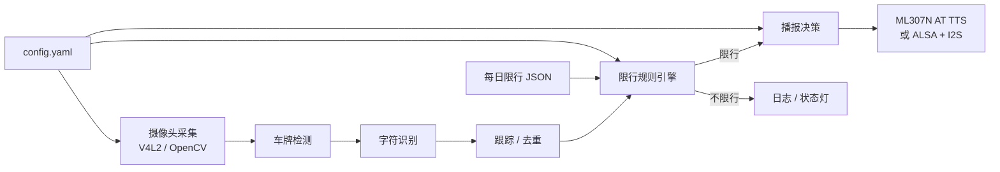
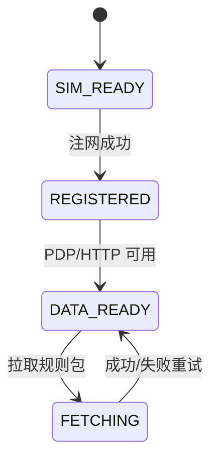
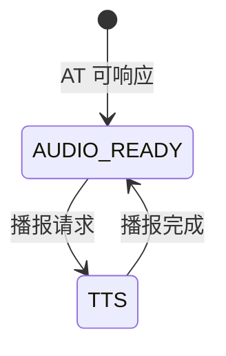

# 软件设计：限行哨兵

> 版本：v0.1（草案） · 日期：2026-10-27 · 状态：设计阶段，尚未实现
> 关联文档：[产品规格](01-product-spec.md) · [硬件特性规格](02-hardware-spec.md) · [测试计划](04-test-plan.md) · [数据契约](../data/README.md)
> 设计评审以 [系统设计基线](06-system-design-baseline.md) 为准；下列接口和技术选型均为草案，尚未实现或冻结。

## 1. 设计目标

1. **本地闭环**：识别、判断、播报全部在设备端完成，不依赖云端。
2. **每天更新**：通过 4G 拉取当天限行 JSON，缓存最近 7 天。
3. **断网降级**：仅在当天数据及其依据可信时判断，否则返回未知并提示。
4. **可测试**：规则引擎是纯函数，单元测试覆盖边界；识别与播报可单独 mock。
5. **隐私优先**：图片不落盘、不上传；日志默认脱敏。

## 2. 运行环境

| 项目 | 选型 |
| --- | --- |
| 硬件 | RDK X5 Module（4GB 起），ML307N Cat.1 |
| 操作系统 | Ubuntu 22.04（地瓜官方镜像） |
| 语言 | Python 3.10（首版）；性能瓶颈再考虑 C++ |
| 视觉 | OpenCV、V4L2；候选 ONNX Runtime / hobot_dnn / rdk_model_zoo |
| 串口 | pyserial |
| 音频 | ALSA；ML307N AT TTS 或本地 TTS |
| 服务管理 | systemd |
| 配置 | YAML |
| 测试 | pytest；规则引擎纯函数测试 |
| 质量门禁 | ruff + ty（Python）；文档 markdownlint |

## 3. 软件架构



模块划分：

| 模块 | 职责 | 首版实现 |
| --- | --- | --- |
| `capture` | 打开摄像头、取帧、断流重连 | OpenCV V4L2 |
| `vision` | 车牌检测、字符识别、置信度过滤 | 候选模型，见第 4 节 |
| `tracking` | 同一车辆多帧去重、冷却时间 | 车牌号 + 时间窗 |
| `rules` | 限行判断、提醒窗口、安静时段 | 纯 Python 函数 |
| `data` | 拉取签名包、验签、校验、缓存、撤回 | HTTP + 本地文件 |
| `notify` | 播报文本、TTS、音量、去重 | ML307N AT 或 ALSA |
| `modem` | ML307N 开机、联网、HTTP、TTS | AT 指令状态机 |
| `config` | 配置加载与校验 | YAML + 数据类 |
| `logging` | 本地日志、脱敏、轮转 | logging + RotatingFileHandler |
| `service` | systemd 启动、看门狗、健康检查 | systemd unit |

## 4. 车牌识别流水线

### 4.1 流程

1. 摄像头以 5fps 取帧，分辨率 1080p，MJPEG。
2. 车牌检测：输出车牌框、置信度。
3. 字符识别：输出车牌字符串与逐字符置信度。
4. 过滤：置信度低于阈值、长度不合法、省份简称不识别的结果丢弃。
5. 去重：同一车牌在冷却时间内只处理一次。
6. 规则判断：调用规则引擎。
7. 播报：按三态与通知策略决定当前提醒、预提醒、核对提示或静默。

### 4.2 模型候选

| 方案 | 组成 | 优点 | 风险 |
| --- | --- | --- | --- |
| A：HyperLPR3 | 检测 + 识别一体化 | 中文车牌适配好，Python 上手快 | CPU 性能、模型许可证待核验 |
| B：YOLO 检测 + OCR | YOLO 车牌检测 + PP-OCR/CTC 识别 | 精度与速度可调，适合 BPU | 需要训练/转换，工具链复杂 |
| C：云端 API | 上传图片识别 | 精度高、开发快 | 隐私、网络、流量、离线不可用；不推荐 |

首版优先 A 做开发板验证；如果单帧超过 500ms 或精度不足，再转 B。**任何模型或预训练权重在合入前必须核验许可证**，优先 Apache-2.0/MIT；AGPL/GPL 模型需要隔离或调整项目许可证，并记录在 [大赛合规](05-competition-compliance.md)。

### 4.3 性能目标

| 阶段 | 目标 |
| --- | --- |
| 采集 | 5fps，单帧 ≤200ms |
| 检测 | ≤300ms |
| 识别 | ≤200ms |
| 端到端 | ≤1.5s（从车辆进入画面到开始播报） |
| CPU | 平均 ≤50%（4 核） |
| 内存 | ≤1GB |

如果 CPU 方案达不到，降级策略：降到 2fps、只在检测到运动时识别、缩小输入分辨率。

## 5. 限行规则引擎

### 5.1 输入与输出

```python
@dataclass
class RuleInput:
    plate: str              # 例：京A12345
    plate_type: str         # blue / green / yellow / unknown
    plate_origin: str       # local / nonlocal / unknown
    timestamp: datetime     # 设备本地时间，带时区
    clock_trusted: bool     # NTP、RTC 或网络时间是否可信
    config: DeviceConfig
    day: LimitDayPackage    # v2 规则包，见 docs/07-data-contract-v2.md

@dataclass
class RuleResult:
    status: str               # applies / does_not_apply / unknown
    rule_id: str | None       # 命中的规则；未知时为 None
    reason: str               # 判断原因或未知原因
    caveats: list[str]        # 不阻断判断、但播报中必须提示的条件
    notification: str         # current_reminder / pre_reminder / verify_prompt / none
    announcement: str | None  # 独立播报文本；不得将预提醒表述为当前受限
    data_status: str          # valid / degraded / unknown
```

### 5.2 判断顺序

1. 数据层校验时钟、签名、契约版本、业务日期、通告有效期、载荷有效期和修订号；任一项失败返回未知。
2. 规则引擎校验覆盖度、规则冲突与端点标志；任一项失败返回未知。
3. 规范化车牌：统一省份简称、字母大小写和分隔符；取最后一位字符作为尾号，数字直接用，字母按 0；无法解析则视为识别失败。
4. 按车辆归属与号牌类型选择规则域：
   - 京牌：仅在规则域覆盖完整、设备可评估的条件满足时判断；无法核验的豁免和车辆类别假设记为 caveat，播报为核对提示。
   - 外埠：进京证、车辆类型、位置或路线不可核验时返回未知。
   - 绿牌：不能仅凭颜色确认豁免；没有明确覆盖该号牌类型的规则域时返回未知。
   - 任一规则域覆盖不完整、车辆条件未知或出现规则冲突时返回未知。
5. 若没有规则命中，只有在该规则域覆盖完整时才能返回不适用；否则返回未知。规则命中只看适用对象与尾号，不看当前是否在窗口内。
6. 生成通知决策：当前限行、预提醒、核对提示或不播报；窗口只决定通知类型，再应用安静时段、去重与冷却。
7. 生成播报文本；默认不播完整车牌。

### 5.3 边界条件

- 具体时间边界按规则包中的 `start_inclusive` / `end_inclusive` 判断；端点未核验（`endpoint_verified=false`）时该规则域返回未知。
- 所引本市尾号通告排除调休上班的周六、周日；其他规则单独核验。
- 取号牌最后一位字符：数字直接用，字母按 0；临时号牌按尾号数字。
- 车牌识别结果的省份简称、字母大小写、分隔点统一规范化后再判断。
- 设备时间未同步时，先用 RTC；RTC 也无效则拒绝判断并亮 ERR 灯。

### 5.4 通知决策、去重与冷却

| 通知类型 | 触发条件 | 默认行为 |
| --- | --- | --- |
| `current_reminder` | 当前时间在规则的限行窗口内，规则命中且数据可信 | 播放当前限行提示 |
| `pre_reminder` | 规则命中且数据可信，当前时间早于下一个限行窗口开始，且在配置的提前量内 | 播放预提醒，不声称当前限行 |
| `verify_prompt` | 车辆相关条件未知（外埠、绿牌、条件缺失），处于提醒窗口且未处于安静时段 | 播放不含车牌的核对提示 |
| `none` | 不适用、窗口外（规则仍可适用）、安静时段或被去重 | 不播报，只记录原因 |

- 所有语音通知还须处于提醒窗口内；提醒窗口默认 06:30–20:30。
- 预提醒只向前看；多窗口规则以下一个尚未开始的窗口计算提前量。进入某窗口后，该窗口不再产生预提醒；后续窗口仍可按提前量提醒；窗口结束后不补发 `pre_reminder`。
- 冷却键为“规范化车牌 + 通知类型”，默认 10 分钟，只从成功播报开始计时。
- 同一车牌从 `pre_reminder` 升级为 `current_reminder` 时允许立即播报，不受冷却限制；升级后重新计时。反向降级不播报。
- 未知状态使用全局冷却（不按车牌区分），默认 10 分钟，避免连续触发核对提示。
- 数据、时钟、签名等全局故障只亮灯并记录，不逐车播放 `verify_prompt`；否则每辆车都会重复提示。
- 安静时段优先于所有语音；不播报不等于判断失败，日志记录抑制原因。

### 5.5 播报模板

| 场景 | 模板 |
| --- | --- |
| 当前在限行窗口内且规则命中 | `当前时段可能限行，请核对。` |
| 尚未进入限行窗口的预提醒 | `今天稍后可能限行，请核对出行时间。` |
| 结果为未知 | `请核对车辆限行和进京规定。` |

默认对可确认的适用规则发出提示；规则不适用保持安静，未知状态可发出不含车牌的核对提示。默认不播完整车牌；如需区分车辆，可选脱敏号牌（如 `京A·1***5`），默认关闭。

## 6. 数据更新与降级

### 6.1 数据契约

设备使用按城市和业务日期发布的 v2 规则包，完整设计见[数据契约 v2](07-data-contract-v2.md)。v1 的 `limit-day.schema.json` 与 `current.json` 仅保留为历史草案，不参与判断。

v2 包由签名信封和载荷组成，端侧至少消费以下字段：

| 字段 | 用途 |
| --- | --- |
| `schema_version` / `min_engine_version` | 契约与规则引擎版本门禁 |
| `city` / `timezone` / `business_date` | 业务日期与适用城市 |
| `revision` | 同一业务日期的单调修订号，用于防回滚 |
| `valid_from` / `valid_until` | 载荷有效区间 |
| `status` | `active` 或 `withdrawn`；撤回后不得继续判断 |
| `source` / `review` | 官方来源、抓取时间和人工复核记录 |
| `coverage` | 每个规则域的覆盖范围与完整度；部分覆盖不得给出“不适用” |
| `rules` | 规则域、适用对象、时间窗口端点、尾号、caveat 与法律依据 |

设备不解析网页，也不自行推断节假日、调休或临时调整；这些结果由发布方在人工复核后写入规则包。

### 6.2 更新策略

1. 每天 00:05 触发拉取；若当时离线，在首次恢复联网时补拉；设备启动后也立即检查。只接受 v2 签名包。
2. 请求顺序由配置的镜像列表决定；所有镜像同等不可信，必须验签，不能把域名白名单当作内容真实性依据。
3. 超时 15s；失败按 1/5/15 分钟重试 3 次，之后每 30 分钟低频重试，直到成功或业务日期结束。
4. 校验顺序：信封与 JSON Schema → 签名 → 契约版本与引擎版本 → 城市与时区 → 时钟可信性 → 业务日期等于当天且位于通告有效期内 → 载荷有效区间 → 修订号单调 → 状态 → 覆盖度、规则冲突、端点与覆盖声明的一致性。任一项失败都保留上一份完整包，但不得用昨日包判断今天，结果为未知。
5. 原子替换：写临时文件、`fsync`、重命名；断电时保留上一份完整记录。
6. 缓存最近 7 天用于审计；只有业务日期匹配且有效的包可用于判断，数据年龄本身不构成可用性。
7. 撤回包到达后停止使用该业务日期的规则并返回未知，不得回退到更低修订号，也不再接受同日期的 `active` 包。
8. 时间与网络异常、签名密钥异常、存储写入失败均需记录原因码，便于现场诊断。

### 6.3 内置轮换表

内置表覆盖 2026-03-30 至 2027-03-28，仅用于人工核对和数据发布交叉校验，不参与自动判断：

| 周期 | 周一 | 周二 | 周三 | 周四 | 周五 |
| --- | --- | --- | --- | --- | --- |
| 2026-03-30 至 2026-06-28 | 2/7 | 3/8 | 4/9 | 5/0 | 1/6 |
| 2026-06-29 至 2026-09-27 | 1/6 | 2/7 | 3/8 | 4/9 | 5/0 |
| 2026-09-28 至 2026-12-27 | 5/0 | 1/6 | 2/7 | 3/8 | 4/9 |
| 2026-12-28 至 2027-03-28 | 4/9 | 5/0 | 1/6 | 2/7 | 3/8 |

轮换表不证明当日适用性；节假日、临时调整或其他关键条件未知时不得给出确定结论，状态灯提示人工核对。

## 7. ML307N 通信

### 7.1 状态机

PWRKEY 拉低 1.2s 后启动模组。数据与音频是两个并行子状态，分别推进：

数据通道：



音频通道：



离线 TTS 不依赖 PDP：音频通道就绪后即可播报，不因未注网或 `FETCHING` 而阻塞。若实际子型号的离线 TTS 需要网络，视为冻结前必须解决的问题，不能把该假设带入设计。

### 7.2 冒烟测试顺序

1. 串口连通：`AT` 返回 `OK`。
2. SIM：`AT+CPIN?` 返回 `READY`。
3. 信号：`AT+CSQ`、`AT+CGREG?` 或模组对应指令。
4. PDP/HTTP：按官方 AT 手册建立上下文，访问一个 HTTPS 测试地址。
5. TTS：按官方指令下发一段中文，确认扬声器出声。
6. 断网重连：拔天线/飞行模式，观察重试与恢复。

> ML307N 的 PDP、HTTP、TTS 指令集以官方 AT 手册为准；不同子型号可能不同。首版优先使用模组内置 HTTP 栈，避免在 RDK X5 上跑 PPP。

## 8. 配置

配置示例见 [firmware/config.example.yaml](../firmware/config.example.yaml)。主要字段：

| 字段 | 说明 |
| --- | --- |
| `device.zone` | `inside_5th_ring` / `outside_5th_ring` / `on_5th_ring_boundary`；边界按未知处理 |
| `reminder.window` | 提醒窗口，默认 06:30–20:30 |
| `reminder.quiet_hours` | 安静时段，默认 22:00–06:00 |
| `reminder.lead_minutes` | 预提醒提前量，默认 30 分钟 |
| `reminder.include_masked_plate` | 播报中是否加入脱敏号牌，默认 false |
| `recognition.cooldown_minutes` | 同车牌同通知类型冷却，默认 10 分钟；预提醒升级不受限 |
| `modem.port` / `baudrate` | ML307N 串口参数 |
| `data.url` / `data.mirrors` | v2 签名规则包地址与镜像列表；全部需验签 |
| `data.refresh_hour` / `data.refresh_minute` | 每日拉取时间，默认 00:05 |
| `data.low_frequency_minutes` | 3 次失败后的低频重试周期，默认 30 分钟 |
| `audio.backend` | `ml307n_tts` / `rdk_i2s` |
| `logging.mask_plate` | 日志脱敏，默认 true |

配置加载时做类型与范围校验；非法配置拒绝启动并写入错误日志。

## 9. 日志、隐私与安全

- 默认日志级别 INFO；记录时间、车牌脱敏值、判断结果、播报结果、规则包修订号、签名 `key_id` 和失败原因码。
- 运行模式不保存或上传原始图片；测试样本的采集、授权、保管和销毁另行审批与记录。
- 日志轮转：单文件 5MB，保留 7 天。
- SSH 仅允许密钥登录；禁止默认密码和密码登录。
- 数据拉取使用 HTTPS；签名、密钥轮换与撤销方案在设计冻结前确定，并在首次现场使用前完成 Ed25519 验签与修订号防回滚的验证。具体契约见[数据契约 v2](07-data-contract-v2.md)。
- 设备外壳贴隐私提示；测试图片必须打码后才能提交到仓库。

## 10. 失败模式与处理

| 失败 | 检测 | 处理 | 状态指示 |
| --- | --- | --- | --- |
| 摄像头掉线 | 连续 10 帧取图失败 | 重新打开设备；每 30s 重试 | ERR 闪 |
| 识别失败 | 置信度低/车牌格式不合法 | 丢弃并记录；不播报 | SYS 正常 |
| 4G 未注网 | 注册状态超时 | 重启模组；使用当天有效包，否则未知 | LTE 慢闪 |
| 数据拉取失败 | HTTP 错误/超时 | 重试 3 次后低频重试；保留旧包，但不得用旧日包判断 | LTE 慢闪 |
| 签名/版本/修订号无效 | 验签失败、版本不支持、修订号回退 | 拒绝替换；当前判断为未知 | ERR 常亮 |
| 数据日期/有效期无效 | 业务日期不匹配、未生效或已过期 | 返回未知，提示人工核对 | ERR 常亮 |
| 当前车辆规则域部分覆盖 | `coverage.completeness=partial` 或端点未核验 | 返回未知，可播核对提示；属于降级，不是数据故障 | ERR 慢闪 |
| 规则冲突或覆盖声明无效 | 重复 `rule_id`、窗口/对象矛盾、scope 不一致 | 拒绝替换；判断为未知 | ERR 常亮 |
| 时间未同步 | NTP 失败且 RTC 无效 | 拒绝判断 | ERR 快闪 |
| TTS 失败 | AT 返回错误/超时 | 重试一次；记录；LED 提示 | ERR 闪 |
| 系统卡死 | systemd watchdog | 重启服务/系统 | SYS 心跳丢失 |

## 11. 数据服务设计（待实现）


- 运行位置：仓库的 GitHub Actions（或自建服务器）负责抓取和校验；签名密钥不放在通用 CI 中。
- 数据源：北京市人民政府通告、交管部门发布信息；解析失败时保留旧包并报警，不自动写入猜测值。
- 人工复核：逐日核对业务日期、尾号、窗口、端点和适用对象；双人复核后批准发布。
- 输出：签名包、发布清单和审计记录；历史归档到 `data/archive/`（待实现）。
- 校验：v2 Schema、业务日期、尾号、窗口、覆盖度、规则冲突、来源哈希与签名。
- 撤回：发布更高修订号的 `withdrawn` 包并通知运维；不得删除历史包。
- 发布：仓库发布页与镜像并行；所有镜像内容必须验签，域名不是信任边界。
- 说明：截至 v0.1，数据服务尚未实现，`data/current.json` 只是 v1 示例。

## 12. 开放问题

1. HyperLPR3 的许可证与在 RDK X5 CPU 上的实际帧率。
2. 是否能将检测/识别模型转换为 BPU 模型；工具链是否可在当前开发环境使用。
3. ML307N 的 TTS 指令、文本长度限制、音频输出电平与噪声。
4. ML307N 内置 HTTP 栈是否支持 HTTPS 与重定向；是否需要 PPP。
5. 官方限行数据页面的结构与访问稳定性；是否需要人工兜底。
6. 设备时间源：NTP 服务器、4G 网络时间、RTC 的优先级。
7. 多车道/多摄像头是否需要首版支持（当前只做单车道）。
8. 是否需要将识别结果推送到物业平台（当前不做）。
9. v2 规则包的签名密钥由谁保管、发布审批与撤回由谁执行？
10. 限行窗口端点（20:00 是否包含）以及绿牌、外埠豁免范围由谁完成法务核验？

## 13. 变更记录

| 日期 | 版本 | 变更 |
| --- | --- | --- |
| 2026-10-27 | v0.1 | 首版草案：流水线、模型候选、规则引擎、数据契约、ML307N 状态机、失败模式 |
| 2026-10-27 | v0.1 | 设计评审修订：三态结果、尾号解析、通知策略、v2 契约校验与 TTS 状态机 |
